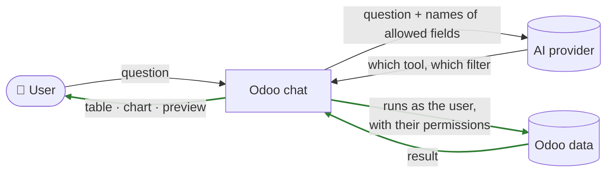
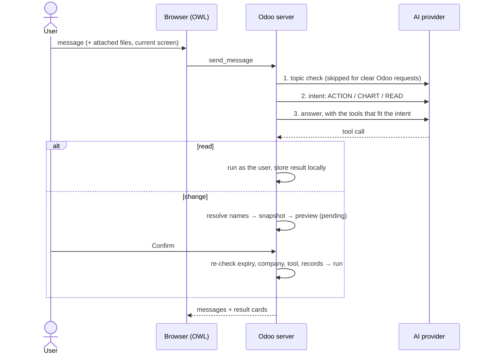

<div align="center">


# Odoo AI Assistant

**Ask Odoo anything. In plain language. Without giving the AI your data.**


</div>

---

> *"Show me open quotations for Acme."* · *"Bar chart of leads by stage."* · *"What's in this PDF?"* ·
> *"Move the lead Website redesign to Qualified."*

The Odoo AI Assistant is a chat built into Odoo. People type a question, in any language, and get the
answer **inside Odoo**: a table of records, a chart, the contents of a file, an explanation of a
screen, or a **ready-to-confirm change**.

What makes it different from pasting things into a chatbot:

| | |
|---|---|
| 🔒 **Your data stays in Odoo** | The AI chooses *what to look up*; Odoo looks it up and shows the result only to you. Record values never reach the AI service unless an administrator allows it **and** you approve each result. |
| ✅ **Nothing changes without Confirm** | Every create, update or delete is shown as a preview first. One click to apply, one click to cancel. |
| 👤 **Same permissions as you** | It can't see or change anything you couldn't in Odoo yourself. |
| 🔌 **Your choice of AI** | OpenAI, Anthropic Claude, Google Gemini or OpenRouter. Switch any time in Settings. |

---

## Who should read what

| You are… | Read |
|---|---|
| 🧭 **Team lead** — deciding, approving, budgeting | [At a glance](#at-a-glance) → [Safety](#safety-by-design) → [Costs](#what-it-costs) → [Status](#project-status) |
| 💬 **User** — using the chat | [Using the assistant](#using-the-assistant) |
| 🛠️ **Administrator** — installing and configuring | [Install in 15 minutes](#install-in-15-minutes) → [Configure](#configure) → [Troubleshooting](#troubleshooting) |
| 👩‍💻 **Developer** — maintaining and extending | [Under the hood](#under-the-hood) |

---

## At a glance

| | |
|---|---|
| **Works in** | Odoo 19 Community, on every screen (chat window), the **AI Assistant** app and **Discuss** |
| **AI providers** | OpenAI, Anthropic Claude, Google Gemini, OpenRouter, with live model lists |
| **What it can do** | Answer questions about Odoo · search, count and list records · charts · read files · prepare changes |
| **Odoo tools it can use** | 17 tools from the MCP Server module (search, read, aggregate, create, update, delete, chatter, attachments, business actions…), plus chart and app/screen tools |
| **Languages** | Understands requests in any language; interface translatable (`i18n/` template included) |
| **Admin control** | One company-wide API key, per-user Yes/No access, per-model Read/Create/Update/Delete switches, usage dashboard and audit log |
| **Size** | ~6,300 lines (Python, JavaScript, XML, SCSS); no database changes to standard Odoo models |

---

## Safety by design

The assistant was built around one rule: **the AI decides what to do; Odoo decides whether it's
allowed and does it.**



The green steps never leave Odoo. Concretely:

- **Results stay local.** Tables, charts and file contents are shown to the user only. The AI is told
  "a result was shown", not what it contained.
- **Records by name, never by ID.** The AI can't guess record numbers. For "move the lead *Website
  redesign*", Odoo itself finds exactly one matching record the user can access, or refuses.
- **Previews are re-checked.** On **Confirm**, Odoo verifies the preview isn't older than 30 minutes
  and that the records, permissions and company selection haven't changed in the meantime.
- **Off-limits, always:** passwords, tokens, keys and similar fields; users, groups and system settings.
- **Opt-in sharing.** An administrator can allow **Share and continue**; even then, users approve
  every single result.
- **Private conversations.** Only their owner can see them.

> ⚠️ Two honest caveats: what users **type** does go to the AI provider, so they shouldn't type
> confidential information; and the API key is stored in the database unencrypted (readable only by
> administrators), so protect backups.

---

## What it costs

The module is free (LGPL-3). You pay the AI provider for usage.

- A chat message makes **2–4 small AI calls**: an "is this about Odoo?" check (often skipped), a
  "read, chart or change?" check, the answer itself, and a title for a new conversation.
- The answer call is the big one: about **10,000 input tokens** in our tests, mostly the assistant's
  built-in instructions. On a paid plan with a "Flash"/"mini" class model, that's **a fraction of a
  cent per message**.
- **Free plans run out quickly** (a few dozen calls a day ≈ a handful of messages). Use a paid plan
  with a budget alert for real use.
- **AI Assistant → Reporting → Usage** shows tokens, calls and active users per day, model, user and
  type of call.

---

## Project status

| | |
|---|---|
| ✅ **Feature-complete** | Chat, records, charts, files (PDF/Office/images), confirmed changes, voice input, Discuss integration, usage reporting, translation template |
| ✅ **Verified** | ~150 scripted checks run during development against a real Odoo 19 database (CRUD, Confirm/Cancel, permissions, files, previews, current screen, charts) — with the AI service replaced by stand-ins, so no credits were spent |
| ⏳ **Not yet** | An automated `tests/` folder in the repository (the checks above aren't committed yet) · an `author` entry in the manifest · Odoo Apps store screenshots |
| ⚠️ **Dependency to watch** | File reading builds on internal methods of the third-party MCP Server module; re-check it after upgrading MCP Server |

---

# Using the assistant

### Open it

| From | How |
|---|---|
| **Any screen** | Click the 🪄 **magic wand** in the top bar. Drag the corner to resize; minimise or expand to full screen. |
| **Full screen** | Open the **AI Assistant** app, or **Discuss → AI conversations**. Past chats are on the left (search box and **Unread** filter). |
| **New chat** | Click **+** in the header. Started from a record? The chat is named after it. |

### Ask

| Try | You get |
|---|---|
| *Which app am I in?* | The app and screen you have open |
| *What can I do in Sales?* · *What fields are on the lead form?* | An explanation based on your real menus |
| *Find quotations for Acme* | A table (with **Next page**) |
| *How many leads per stage?* | Counts |
| *Pie chart of invoices by payment status* | A chart, with **Open in Odoo** for Odoo's own graph and pivot views |
| *Create a company contact Acme in Pune* | A preview → **Confirm** or **Cancel** |
| *Schedule a call on that lead next Monday* | A preview of the activity |

Unrelated questions get a polite *"I can only assist with Odoo…"*.

### The ➕ menu

At the left of the message box, exactly like Discuss:

- **Attach Files** → the file appears as a card above the message box (first-page preview for PDFs,
  thumbnail for images; **×** to remove). Ask about it, or send it on its own.
- **Voice Message** (or **Alt + V**) → speak; your browser types it. Edit, then send.

| File | What the assistant reads |
|---|---|
| PDF, Word, Excel, PowerPoint, OpenDocument | The text — PDF table rows stay on one line |
| PNG, JPEG, GIF, WebP | The image (large ones as a smaller preview) |
| TXT, CSV and other text | The text |
| Scanned PDFs | ✗ Not readable — they contain pictures of text, not text |

Files you attach stay in your conversation (deleted after a day) unless you ask the assistant to
attach one to a record — which, like every change, needs **Confirm**. You can also ask about files
already attached to records.

---

# Install in 15 minutes

### What you need

| | |
|---|---|
| **Odoo 19 Community** | Running, with administrator access |
| **MCP Server** (`mcp_server`) | Free on the [Odoo Apps store](https://apps.odoo.com/apps/modules/19.0/mcp_server) — third-party, **not included here** |
| **Python packages** | `markdown2`, `jsonschema` — and optionally `pdfminer.six` for PDFs (Odoo's official installers already include it) |
| **An AI API key** | From OpenAI, Anthropic, Google or OpenRouter |

<details>
<summary><b>New to Odoo? A few words explained</b></summary>

| Word | Meaning |
|---|---|
| **Module / app** | A package that adds features to Odoo. |
| **addons path** | Folders where Odoo looks for modules — the `addons_path` line in `odoo.conf`. |
| **API key** | A secret password from the AI provider, created on their website. |
| **Model** | A specific AI (e.g. a "Flash" or "mini" model) — they differ in quality, speed and price. |
| **Token** | What providers charge by; roughly 4 characters of text. |
| **Developer mode** | Shows advanced options: **Settings** → bottom of the page → **Activate the developer mode**. |

</details>

### Steps

1. **Copy** the `odoo_ai_assistant` and `mcp_server` folders into a folder on your Odoo **addons path**.
2. **Install the Python packages** with the Python that runs Odoo:

   ```bash
   pip install -r odoo_ai_assistant/requirements.txt                          # Linux / macOS
   C:\Odoo\venv\Scripts\pip install -r odoo_ai_assistant\requirements.txt     # Windows (example path)
   ```

3. **Restart** the Odoo server.
4. In Odoo: **Apps** → **Update Apps List** (developer mode) → search **Odoo AI Assistant** →
   **Activate**. MCP Server and Odoo's *Document Indexation* module come along automatically.

**Upgrading later:** replace the folder → restart Odoo → **Apps** → **Upgrade** → users reload with
**Ctrl + Shift + R**.

---

# Configure

**AI Assistant → Configuration → Settings** (administrators only):

| # | Do this | Default |
|---|---|---|
| 1 | Tick **Enable AI Assistant** | Off |
| 2 | Choose the **AI provider**, paste the **API Key**, pick an **AI Model**, **Save** | — |
| 3 | Per user: **Settings → Users → Access Rights → AI → AI Assistant = Yes** | No |
| 4 | **Let the AI read Odoo data** — search, count, chart | On |
| 5 | **Let the AI prepare changes** — previews to confirm; also enables **Attach Files** | Off |
| 6 | **Let the AI see menu and screen names** — explain screens, know where the user is (names only, never record values) | Off |
| 7 | **Choose which Odoo data the AI may use** — per model: **Read**, **Create**, **Update**, **Delete**, **Method calls** | — |

Users still only reach what their own access rights allow. MCP Server's separate switch for *external*
AI apps isn't needed and can stay off.

<details>
<summary><b>Advanced settings (developer mode)</b></summary>

| Setting | Default | Range |
|---|---|---|
| Allow sharing results with the AI provider (**Share and continue**) | Off | |
| AI data requests per user per minute | 60 | 1 – 600 |
| Maximum answer length (tokens) | 2,048 | 256 – 65,536 |
| Provider timeout (seconds) | 60 | 10 – 600 |

</details>

---

# Troubleshooting

| You see | Fix |
|---|---|
| No 🪄 in the top bar | Settings step 1 and 3, then reload |
| *"Select an available model in AI Settings first."* | Choose a model (step 2) and save |
| HTTP **401 / 403** | The provider rejected the API key |
| HTTP **404 … model not found** | Your account can't use that model — choose another |
| HTTP **429 … rate limit or usage quota** | Provider plan limit reached — wait, or move to a paid plan |
| *"Native MCP rate limit reached…"* | Too many data requests in a minute (Advanced settings) — wait a minute |
| *"I can only assist with Odoo…"* for an Odoo question | Name the app: "…in CRM" |
| *"… is not available for charts"* | Enable **Read** for that model (step 7) |
| No **Attach Files** in ➕ | Turn on steps 4 **and** 5 |
| *"No inline text could be extracted…"* for a PDF | Install `pdfminer.six` and restart Odoo — or it's a scanned PDF |
| *"This tool request expired…"* | Preview older than 30 minutes — ask again |
| Screen looks broken after an upgrade | **Ctrl + Shift + R** |

**Limits worth knowing:** chat charts show up to 50 groups (**Open in Odoo** shows all) · money is
summed within one currency · images over 10 MB come as a download link · shared results max 100,000
characters and four images · no internet lookup.

---

# Under the hood

### How a message flows



### Design decisions

| Decision | Why |
|---|---|
| Results stored locally; history sends a placeholder | Record values never leak through conversation history |
| `$odoo_ref` local references instead of IDs | The AI can't know IDs; Odoo resolves names to exactly one accessible record |
| Snapshot + digest on every preview | **Confirm** can't apply a change to records that moved since the preview |
| Separate intent classifier (ACTION / CHART / READ) | Each request is offered only the tools that fit; works in any language |
| Staged files referenced as `upload:<id>` | The server attaches the reference for the AI; users only see a file card |
| Current screen validated against the user's menus | The browser can't inject arbitrary text into the AI's instructions |
| All limits in `limits.py` | One place to tune; no magic numbers in code |

### Project map

```
odoo_ai_assistant/
├── models/
│   ├── conversation.py   chat flow · intent and topic checks · tool dispatch · history · attached files
│   ├── providers.py      OpenAI / Claude / Gemini / OpenRouter clients · instructions · classifiers
│   ├── native_mcp.py     MCP tools · previews and Confirm · safety checks · file reading · audit
│   ├── tools.py          chart tool · app / screen / version tools
│   ├── navigation.py     the user's apps, menus and screens · current-screen check
│   ├── mcp_bridge.py     read-only grouping for charts
│   ├── configuration.py  AI Settings · model catalogue · per-user access
│   ├── usage.py          usage log and dashboard data
│   ├── discuss.py        keeps AI conversations private in Discuss
│   ├── formatting.py     safe Markdown rendering of AI answers
│   └── limits.py         every limit, lifetime, protected model and the credential-field filter
├── static/src/
│   ├── assistant.*       chat window · AI app · ➕ menu · file cards · voice input
│   ├── visualization.*   charts · tables · tool-request cards
│   ├── graph_patch.js    sharper "Open in Odoo" graphs (lazy bundle, see below)
│   ├── discuss.*         "AI conversations" in Discuss
│   └── usage_dashboard.* the Usage report
├── views/ · security/ · data/
└── i18n/                 translation template (odoo_ai_assistant.pot)
```

### Where to change things

| To change | Go to |
|---|---|
| A limit, lifetime or cap | `models/limits.py` |
| Protected models / credential fields | `RESTRICTED_MODELS`, `RESTRICTED_MODEL_PREFIXES`, `CREDENTIAL_FIELD` in `limits.py` |
| The assistant's instructions | `_reply_once()`, `is_odoo_topic()`, `request_intent()` in `providers.py` |
| Which MCP tools are offered | `_BUILTINS` in `native_mcp.py` (data-changing tools always need Confirm) |
| How results and previews look | `NativeToolRequest._payload()` in `native_mcp.py` · `visualization.xml` |
| How files are read | `_extract_attachment_text()` · `_attachment_auto_result()` · `_resolve_read_attachment_target()` in `native_mcp.py` |
| Add an AI provider | `PROVIDERS`, `BASE_URLS`, then `_reply_once()`, `_tokens()`, `models()` in `providers.py` |

### Workflow

```bash
odoo-bin -c odoo.conf -d <db> -u odoo_ai_assistant --stop-after-init   # after Python / XML / manifest changes
odoo-bin i18n export -c odoo.conf -d <db> odoo_ai_assistant             # refresh the translation template
```

- Restart the server after Python changes; **Ctrl + Shift + R** after JavaScript, templates or styles.
- ⚠️ **Odoo 19 loads graph and pivot views from the lazy bundle `web.assets_backend_lazy`.** Anything
  that imports or patches them belongs there (like `graph_patch.js`), never in `web.assets_backend` —
  otherwise the import fails and takes the chat (and Discuss) down with it.
- Template extensions of stock screens are null-safe (`aiState?.…`) so a script failure can't break
  standard Odoo.
- Server logs show request sizes and timings for every AI call, never message content.

---

<div align="center">

**LGPL-3** · see [LICENSE](LICENSE) · the required `mcp_server` module is distributed separately under its own license

</div>
